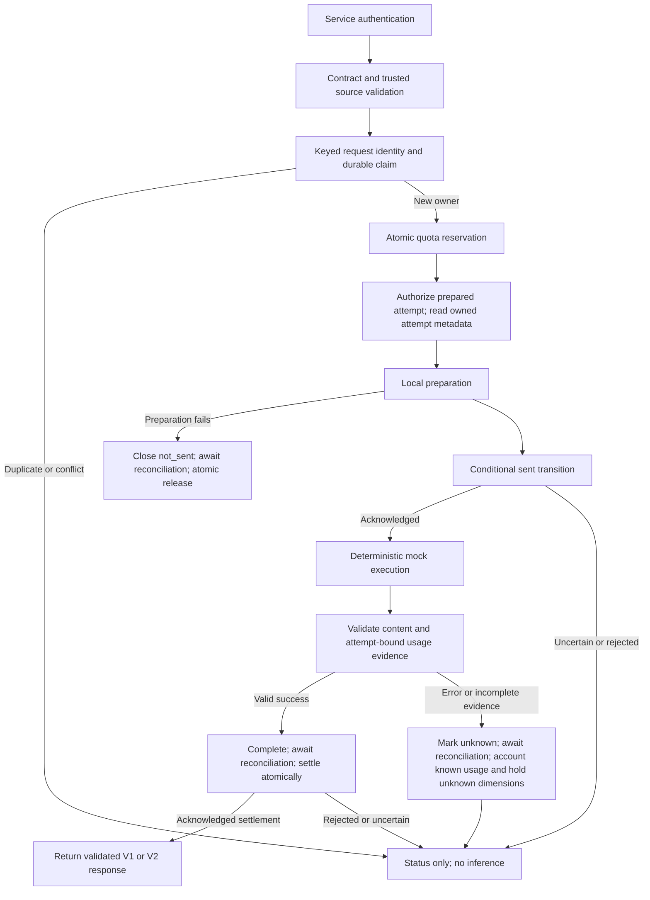

# Durable local request pipeline (Part 4D-5)

The ResearchBridge project composes the existing admission, idempotency,
lifecycle, settlement, failure and recovery components for deterministic local
mock execution. Production inference remains unconditionally disabled. This
stage adds no migration, live adapter, fallback, cooldown or cleanup process.



## Composition and configuration

`localServices(env, config)` constructs `DurableRequests` with the existing
`D1IdempotencyStore`, `D1QuotaAdmission`, `D1UsageSettlement` and
`D1FailureAccounting`. The new `readOwnedAttempt` adapter uses the existing
bounded recovery snapshot/classifier to check ownership and return IDs plus
original quota metrics. It does not acquire authority or mutate counters.
Every subsequent transition/accounting write checks durable authority again.

`src/local.ts` parses server-owned `LOCAL_DURABLE_CONFIG`. The local gateway
requires these protections even for mock requests; omitting `durable` or its
accounting dependencies cannot enable generation. The lower-level
`DurableRequests` constructor still supports admission/lifecycle-only callers,
but those objects cannot run the gateway. There is no unmetered fallback.

Required configuration:

| Setting | Requirement |
| --- | --- |
| `COACH_SERVICE_SECRET` | Random 32-byte service credential encoded as 64 lowercase hex characters. |
| `COACH_FINGERPRINT_SECRET` | Independent random 32-byte key for private request fingerprints, in the same encoding. |
| `COACH_DB` | Local D1 with migrations 0001–0008 applied. Missing binding fails closed. |
| `LOCAL_MOCK_ENABLED` | Exactly `true`; accepted only by the loopback local entry. |
| `MOCK_SCENARIO` | An enumerated internal mock case; never accepted from request data. |
| `LOCAL_DURABLE_CONFIG.ownership` | Explicit `leaseSeconds`, `ttlSeconds`, `retentionSeconds`, validated by the existing owner policy. |
| `LOCAL_DURABLE_CONFIG.quota` | A `QuotaAdmissionPolicy` for provider `mock`, model `mock-model`, explicit scope, leases and quota windows. |
| `LOCAL_DURABLE_CONFIG.estimate` | Trusted integer-safe admission estimate with every required request/token/compute dimension. |

Supply `LOCAL_DURABLE_CONFIG` as JSON in the ignored local environment file.
The local factory copies it before use. Quota windows must already exist and
match the configured IDs, scope, model, units, limits, safety margins and times.
No limits, reset times, implicit compute conversions or production credentials
are supplied. Missing/expired/malformed windows deny admission. The local
Wrangler config now has the same all-zero placeholder D1 ID as the local schema
config; it is not a remote resource. Use only `--local` commands with these files.

The deterministic seven-window fixture in `tests/local-pipeline-fixture.ts`
demonstrates configuration and isolated local seeding. Its capacities and usage
values are synthetic test data, not recommended provider limits. The normal
entry does not seed, reset or automatically roll over any window.

## Dispatch and ownership boundary

Authentication, request/response-version validation and permitted source
resolution precede any claim. The existing fingerprint covers the validated
request, resolved source and response version. Authentication identifies the
Streamlit service, not an individual student. Request headers/body fields cannot
supply a trusted student identity, owner token, provider, model or usage report.
Every generation request must supply `X-ResearchBridge-Request-ID` as a UUIDv4.
Reusing that ID with changed task, source or response-version data conflicts.

Admission returns the reservation ID. Authorization returns a newer fence, and
the bounded owned-attempt read checks claim ID, service, hashes, generation,
active lease/TTL, reservation, attempt and original quota links. The gateway
checks provider/model against both admission and the configured mock identity.
The provider receives only task data and provider/model/reservation/attempt IDs;
it never receives the owner token, fingerprint key, fencing capability or DB.

Local preparation is synchronous and must perform no dispatch or external I/O.
A preparation exception uses the fenced `failBeforeDispatch` transition,
`awaitReconciliation`, then the existing atomic failure release. An ambiguous
closure/queue/refund stops processing; it never causes an inferred refund.

Provider invocation follows only an acknowledged conditional `dispatch` write.
Zero-row or ambiguous authorization/dispatch acknowledgements never permit a
provider call. A lease/generation change detected by that write prevents send.
All outcomes use the latest acknowledged fence. Post-dispatch lease expiry or
ownership loss blocks settlement, retaining conservative accounting for review.

There is an irreducible gap between D1 committing `sent` and invocation. A crash
can leave `sent` even when nothing was sent. A timeout or crash after invocation
does not prove the provider stopped. There is no distributed transaction with
the provider and no exactly-once external-execution guarantee. No other owner
automatically takes over, redispatches, or refunds that possibly dispatched work.

## Usage and accounting

`mock-evidence.ts` accepts only internal `local_mock` envelopes matching the
admitted provider/model and exact reservation/attempt IDs. It reuses the existing
settlement/failure normalizers for allowed fields, safe integers, consistent
token totals, named units and explicit conservative estimates. It verifies
successful evidence covers every original window. The envelope tag is not a
cryptographic attestation: safety relies on internal construction, no public
usage input, and the fixed local mock boundary. It is not a live provider parser.

The mock's legacy `usage.kind = simulated` field remains separate and is not
used for settlement. The attempt-bound fixture evidence exercises the existing
`measured` and `estimated` receipt formats only in local D1. Those numbers are
synthetic mock observations, never claims about real provider consumption.

Valid content plus complete usage follows `complete`, `awaitReconciliation`,
then atomic successful settlement. Only acknowledged `settled`/`already_settled`
permits returning private content. Receipts retain the current generation and
existing canonical format. Below/equal/above-reservation consumption is recorded
without truncation. Overages may exceed a quota limit; subsequent admission fails
closed according to the existing policy.

| Observation | Lifecycle and accounting |
| --- | --- |
| Proven preparation failure | `not_sent`; atomic release with a proven non-dispatch receipt. |
| Timeout or generic execution exception | `unknown`; preserve holds unless independent valid usage is available. |
| Simulated provider HTTP error | `unknown`; account validated partial/full usage, keep missing dimensions held. HTTP status alone never proves zero consumption. |
| Invalid response content | `unknown`; preserve independently validated usage, including overages; no private output returned. |
| Missing, incomplete or invalid success usage | `unknown`; preserve supported validated fields and hold unknown dimensions. No fabricated zero or invented upper bound. |
| Storage failure after possible dispatch | No further inference; current durable outcome/counters remain available for inspection. |

Successful content with failed/uncertain settlement is discarded from the HTTP
result. A completed lifecycle status means the provider outcome was marked
completed, not that accounting is confirmed. Status-only replay may therefore
report `completed` even when reconciliation needs inspection. It never replays
private content or authorizes inference/another accounting write. Accounting
failures return sanitized status with `retryable: false`; provider/contract errors
retain the existing error format. No response includes internal usage or secrets.

## Uncertainty, duplicate handling and explicit recovery

The gateway never automatically retries a provider call or an uncertain write.
Existing claim lookup can describe a possibly committed claim/admission without
returning its owner capability. A matching committed accounting receipt can be
verified through the existing inspection/repeat-safe APIs. Conflicting payloads,
stale generations and unknown outcomes cannot acquire new processing authority.

Recovery is an explicit internal call, independent of ordinary generation:

```typescript
const services = localServices(env, trustedConfig);
if (!services) throw new Error("Local configuration unavailable");
const recovery = await services.recovery(serviceRequest, { leaseSeconds: 60 });
const page = await recovery.discover({
  basis: "reservation_expiry", from: intervalStart, through: intervalEnd, limit: 20,
});
// Review the classification and use the exact observed identities/generation
// and a stable operation UUID for an explicitly selected eligible record.
```

The existing recovery API authenticates that invocation. The caller manages both
scan streams, fixed intervals, cursors and bounded overlap. Only proven terminal
non-dispatch records with expired original leases can acquire recovery authority.
The original generation advances; stale owner writes are rejected. Claim/release
duplicates and ambiguous acknowledgements retain Part 4D-4's receipt rules.
No public recovery endpoint, automatic per-request scan, recovery scheduler,
cleanup or deletion is added. See [RESERVATION_RECOVERY.md](RESERVATION_RECOVERY.md)
for retention prerequisites and the unresolved replay-tombstone horizon.

## Verification and limits

Run `npm.cmd run test:pipeline`, `npm.cmd run typecheck`, and `npm.cmd test`.
The full suite includes recovery, failure/success accounting, lifecycle,
idempotency, quota admission, local migration reapplication, workerd and shared
Python/TypeScript contract parity. Set `RESEARCHBRIDGE_PYTHON` to the project's
Python executable when needed. No Python application code changes are required.

Integration tests inject failures before and after claim, admission,
authorization, owned-attempt read, sent, completion, reconciliation marking and
accounting transactions. They check rollback, concurrent duplicates, stale
owners, expiry, receipt reuse, restarts, privacy and controlled recovery using
real local D1. Outbound service access is blocked. No production account behavior
or live provider execution is tested.

Production blockers remain separate from the mock test limits: trusted provider
allowances and estimation policy, verified live usage parsing, real retrieval
authorization, provider error semantics, operational reconciliation of unknown
outcomes, quota-window provisioning, review procedures, deployment/security
review, per-invocation database query/CPU budgets for the configured number of
windows, and explicit authorization to enable inference. Tombstone retention still
requires a proven replay/freshness policy; terminal receipt correction and
post-dispatch recovery are not implemented. Service authentication does not
provide student-level enforcement or private-response replay.

Test-only limits include synthetic usage, accelerated error/timeout cases and
local D1/workerd rather than remote infrastructure. Counter inspection remains
bounded per reservation rather than a global ledger audit. The existing window
identity permits only one token metric for an otherwise identical window;
tests use distinct configured windows for input/output/combined dimensions.
Local execution does not establish remote transaction, rate or query-budget
compatibility; this integration performs several guarded batches per request.

The integrated local foundation is ready for separately scoped Part 4E design
and tests. No provider cooldown policy is implemented or assumed here. Passing
these tests is not authorization or readiness to enable production inference.
