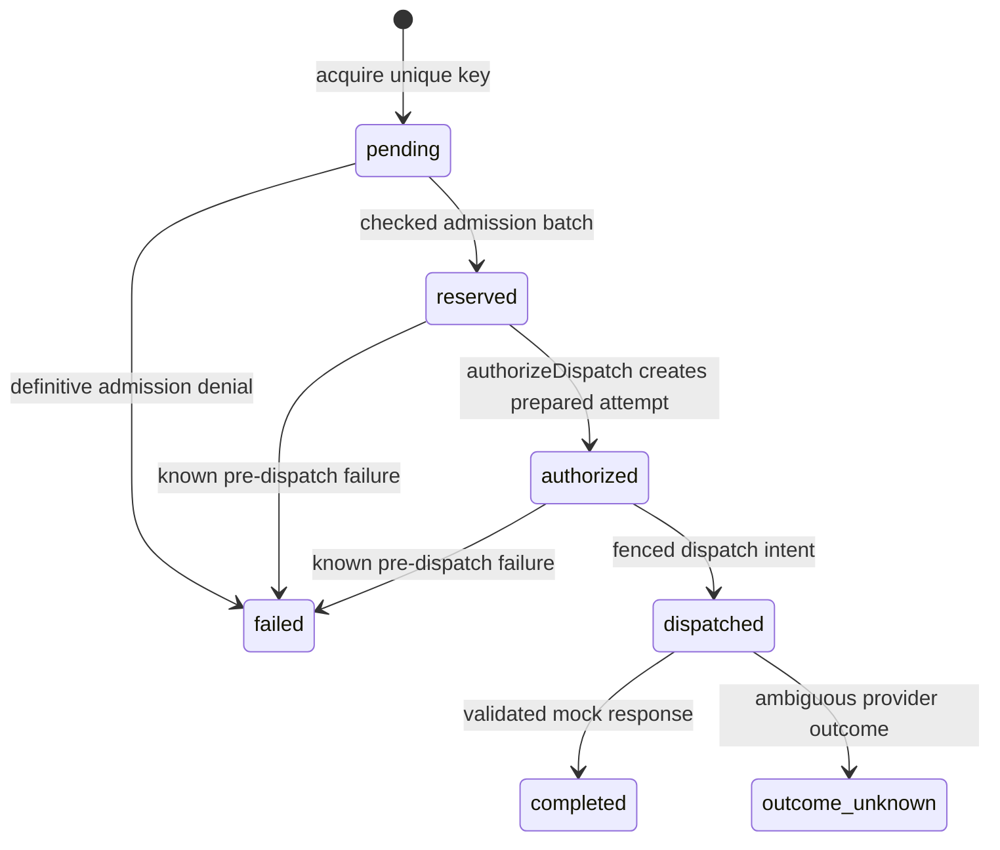

# Durable request idempotency (Part 4C)

ResearchBridge's `D1IdempotencyStore` and `DurableRequests` coordinator bind
authenticated request ownership to Part 4B admission. The existing local gateway
accepts an optional `durable` dependency. Production still refuses inference.
No live provider, public admission endpoint or shared response cache is added.

## Ownership and local composition

The gateway authenticates the existing server-to-server bearer credential,
rejects browser-originated requests, validates the Learning Coach contract and
resolves trusted sources before fingerprinting. `serviceId` comes from the
authenticated principal, currently the `streamlit` service, never the body.

There is no trusted student/session identity in the current architecture.
Arbitrary user IDs and browser session headers do not establish one. Anonymous
sessions are not verified student identities. Consequently replay is **status
only**, scoped to the authenticated service. No previous private response can
be retrieved, even using another session's request ID. The server must keep
credentials server-side and route the first fresh response to its own caller.

The trusted server supplies a lowercase UUIDv4 in `X-ResearchBridge-Request-ID`
and reuses that ID for retries of the same operation. Durable mode requires this
header. Session headers are ignored for ownership. Different services have
independent key namespaces and cannot read or transition each other's claims.

Explicit local composition uses trusted policies and a separate 256-bit
fingerprint secret (64 lowercase hex characters), with no bearer-key fallback:

```ts
const store = new D1IdempotencyStore(env.COACH_DB, {
  leaseSeconds, ttlSeconds, retentionSeconds,
});
const durable = new DurableRequests(
  store, new D1QuotaAdmission(env.COACH_DB, quotaPolicies),
  fingerprintSecret, trustedAdmissionPlan,
);
const gateway = createGateway({
  mode: "local", enabled: true, durable,
  provider: new LocalMockProvider(), sources: new MockSourceResolver(),
});
```

Durations are positive integer seconds, with lease <= TTL <= retention, and
each at most one year. They are caller-selected metadata durations, not usage
allowances. The plan supplies a trusted provider/model and integer estimates.
Missing configuration fails closed. Default `src/local.ts` remains the original
stateless contract mock and reserves no quota. Durable composition is exercised
by gateway tests and a bundled workerd test against real local D1; no deployment
configuration or remote binding is enabled.

## Canonical identification and privacy

Canonicalization recursively sorts object keys in JavaScript UTF-16
lexicographic order and preserves array order. JSON decoding makes equivalent
escape spellings identical. Whitespace, case, string contents and Unicode
normalization forms remain exact; absent fields are not synthesized. Unsupported
JSON values are rejected. Contract validation is unchanged.

The envelope includes a format identifier, authenticated service, request
contract version, task identity, response version, validated request and resolved
source title/abstract. Changed resolved source content conflicts with a reused
ID even if its source reference is unchanged.

`crypto.subtle` computes the HMAC-SHA-256 payload fingerprint. A separate HMAC
domain identifies the fingerprint key. SHA-256 over a separate domain, service
and opaque UUID supplies the stable key lookup. Rotating the HMAC key therefore
cannot create another claim for an existing ID: a key-identifier mismatch fails
closed pending an explicit rotation procedure. These APIs are supported by
[Workers Web Crypto](https://developers.cloudflare.com/workers/runtime-apis/web-crypto/).

Only hashes, service identifiers and lifecycle metadata enter D1. Reservations
correlate through a random claim UUID. No raw prompt, reflection, response,
student identifier, browser session ID or credential is stored. Ownership
tokens are random 256-bit internal capabilities; only SHA-256 hashes are stored.
Tokens, hashes, fingerprints and secrets are never sent in status responses or
logged by this implementation.

## Atomic ownership and fencing

The existing unique `(service_id, key_hash)` constraint arbitrates acquisition
through `INSERT ... ON CONFLICT DO NOTHING`. Only an acknowledged one-row insert
returns a capability. Duplicates receive status only; differing payloads or
response versions receive `conflict`.



A pending claim may safely have no reservation. Admission inserts a reservation,
conditionally advances the claim to `reserved`, and links the reservation in
the **same batch** as all quota updates and window links. Immediately checking
`ownership_check = changes()` on that newly inserted reservation forces a
constraint error for missing, expired or stale claims. Part 4B's per-window
assertions continue to roll back everything if any dimension fails. A unique
foreign-key reservation link prevents two claims from sharing a reservation.

Each accepted transition increments `generation`. Writes match service, key,
payload, fingerprint key, response version, owner-token hash, prior generation,
permitted state and active lease/TTL. A checked `transition_check = changes()`
turns zero-row transitions into transaction errors. Stale owners cannot dispatch,
complete, mark unknown or overwrite terminal states. No JavaScript lock is
authoritative. D1's rollback-on-error behavior is documented in its
[batch API](https://developers.cloudflare.com/d1/worker-api/d1-database/#batch).

Part 4D-1 adds explicit authorization before dispatch. Authorization creates a
`prepared` attempt and advances the fence; dispatch requires that prepared
attempt and an unexpired quota reservation. It marks reservation/attempt `sent`
in one checked transaction. Completion, pre-dispatch failure and unknown outcome
now update reservation and attempt consistently. A separate reconciliation
marker preserves terminal outcomes. See
[RESERVATION_LIFECYCLE.md](RESERVATION_LIFECYCLE.md). These transitions do not
settle counters, release capacity or write usage accounting.

## Replay, expiry and uncertainty

| Condition | Result |
| --- | --- |
| Exact active duplicate | `pending`, `reserved` or `dispatched`; no new owner/reservation |
| Same ID, different payload/version | `conflict` |
| Completed request | `completed` metadata only; no generation or private replay |
| Known pre-dispatch failure | `failed`; no reacquisition under that ID |
| Provider timeout/ambiguous outcome | `outcome_unknown`; no automatic redispatch |
| Processing lease expired | Conservative `outcome_unknown`; no takeover |
| Request TTL expired | `expired`; retain the record as a replay tombstone |
| Stale transition | `stale_owner`; no overwrite |
| Missing storage/configuration | Closed status without internal error details |

No failed, expired or unknown request automatically retries under the same ID.
An intentional new request requires a new UUID and normal admission. A new UUID
must not be used as an automatic retry for ambiguous work. Reserved capacity
remains held for future settlement decisions.

A timeout may occur after a D1 write commits. Claim exceptions trigger a status
read, never ownership recovery or a repeated write. Ambiguous admission returns
durable status without dispatch authority. Ambiguous dispatch/completion fails
closed; later requests inspect state without repeating the operation. Stale
reads may cause conservative denials but cannot grant ownership.

Fresh mock responses undergo existing V1/V2 validation and the response-size
limit before completion is recorded. Retained response size is zero bytes.
Duplicates receive a separate small envelope containing request ID, state,
`retryable: false` and `replay: "status_only"`, with `Cache-Control: no-store`
and a replay header. Active states use HTTP 202; completed uses 200;
conflict/failed/unknown/stale use 409; expired uses 410; unavailable storage or
configuration uses 503. Educational response schemas remain unchanged, and
status-only replies are never described as newly generated output.

TTL bounds active processing. `retain_until` is earliest cleanup eligibility,
not permission to delete replay tombstones. No cleanup is introduced: deletion
would permit key reuse. A future bounded tombstone/issuer policy must preserve
replay rejection before deleting keys.

## Migration, verification and remaining work

`0004_durable_idempotency.sql` adds lifecycle, key identifier, hashed ownership
token, generation, lease, reservation link and checked assertion fields. Existing
tables and original migrations are preserved. The old `status` is a compatibility
summary; `processing_state` is the new authoritative lifecycle. Legacy
completed/unknown states carry forward; records without new metadata fail closed.

Run `npm.cmd run test:idempotency`, `npm.cmd run test:admission`,
`npm.cmd run test:db`, `npm.cmd run typecheck` and `npm.cmd test`. Tests cover
concurrent claims/transitions, shared capacity, multi-window rollback with claim
linkage, stale owners, actual workerd crypto, HTTP authorization, status-only
replay, privacy, ambiguous writes, expiry, migrations and runtime restarts.
All database execution is local.

This does not claim exactly-once provider execution. A crash after dispatch
intent can leave an unknown outcome. There is no automatic takeover/recovery
dispatch, verified student identity, private-response replay or cleanup.

After Part 4D-1, subsequent parts must implement repeat-safe usage accounting,
checking durable claim/attempt fencing in the same transaction and rejecting
stale settlement authority. Unknown usage must remain conservative, with
counters, dimension links and accounting records consistent. `UsageReporter`
remains unimplemented; this stage cannot authorize settlement. Provider holds,
signed request freshness and live inference remain separate work.
