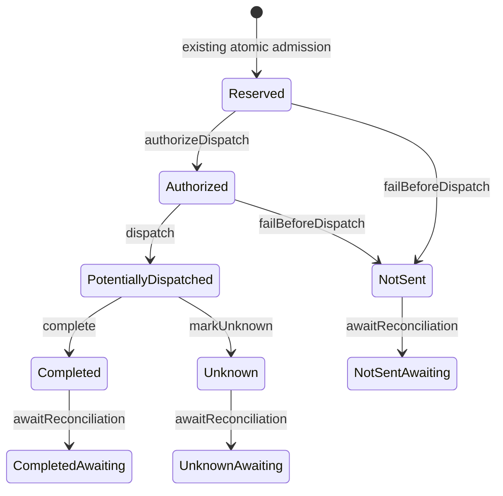

# Reservation lifecycle (Part 4D-1)

ResearchBridge's `ReservationLifecycle` interface is implemented by the existing
`D1IdempotencyStore`. Every lifecycle edge uses the existing authenticated claim
and fencing capability. No additional tables, usage settlement, counter updates,
provider holds, cleanup or recovery dispatch are introduced.

## Durable states and allowed edges

The existing reservation and attempt enums are retained. Authorization is
represented by a `prepared` attempt; awaiting reconciliation is a separate
reservation marker, preserving the recorded outcome.

| Lifecycle meaning | Claim `processing_state` | Reservation `status` | Attempt `status` |
| --- | --- | --- | --- |
| Reserved, not authorized | `reserved` | `reserved` | No attempt |
| Dispatch authorized | `reserved` | `reserved` | `prepared` |
| Dispatched or potentially dispatched | `dispatched` | `sent` | `sent` |
| Successfully completed | `completed` | `completed` | `completed` |
| Failed before dispatch | `failed` | `not_sent` | `not_sent` |
| Outcome unknown | `outcome_unknown` | `unknown` | `unknown` |
| Awaiting reconciliation | Preserve terminal value | Preserve terminal value; `reconciliation_state = 'awaiting'` | Preserve terminal value |

The three `Awaiting` nodes are metadata views of the same immutable terminal
outcome, not new execution states. There is no edge from a terminal outcome back
to reserved, authorized or sent, or from unknown to completed. A pending claim
that never obtained a reservation may transition to `failed` after a definitive
admission denial; it creates no reservation/attempt and cannot request
reconciliation of nonexistent capacity.

## Transition operations

* `authorizeDispatch(fence)` creates exactly one `prepared` attempt with no
  `sent_at` or `finished_at`. It requires a reserved, unexpired admission and no
  existing attempt. The returned fence has the next generation.
* `dispatch(fence)` requires that prepared attempt and active reservation lease.
  It atomically records `sent` on reservation and attempt and `dispatched` on the
  claim, setting `sent_at`. Calling it before authorization is rejected.
* `complete(fence)` requires the dispatched/sent combination and atomically
  closes reservation and attempt as `completed`. The gateway calls it only after
  existing response validation. No private response is stored.
* `failBeforeDispatch(fence)` closes an unattempted or prepared reservation as
  `not_sent`. It creates a terminal `not_sent` attempt if none existed, or closes
  the same prepared attempt. It cannot run after dispatch intent.
* `markUnknown(fence)` closes a dispatched attempt and its reservation as
  `unknown`, with claim state `outcome_unknown`. It does not refund or redispatch.
* `awaitReconciliation(fence)` marks a consistent terminal reservation as
  awaiting future reconciliation and records the D1 timestamp. It increments
  the fencing generation without changing claim/attempt outcome or accounting.
  A duplicate marker request is rejected, including with the latest fence.

`sent_at` records dispatch intent before the provider call; it does not prove
provider execution. `finished_at` closes the recorded attempt observation. For
an unknown outcome, it does not prove the provider stopped executing. The local
mock gateway now calls authorization and dispatch separately, passing each
acknowledged new fence onward before invoking its mock provider.

## D1 enforcement and concurrency

The first conditional write validates service, claim ID, key and payload hashes,
fingerprint-key identifier, response version, owner-token hash, expected
generation, active claim lease/TTL and the full prior-state combination. It
checks the reservation's service/request linkage and admission dimension links,
including scope/provider/model agreement and positive integer reserved amounts.
It never grants authorization from a read or an unadmitted claim.

All related claim, reservation and attempt writes execute in one prepared D1
batch. Immediately following each write, a checked `changes()` assertion forces
a statement error if the required row count is not met. D1 rolls back the whole
batch on a statement error; a zero-row conditional update by itself would not
roll back earlier writes. See [D1 batch semantics](https://developers.cloudflare.com/d1/worker-api/d1-database/#batch).

Reservation-backed mutations must affect one row each. For failure of a pending
unadmitted claim, the same durable claim row explicitly establishes that related
reservation/attempt mutations must affect zero rows. These assertions are in
SQL, not just post-commit checks. Returned affected-row counts are additionally
verified before returning an updated capability.

Every accepted edge increments the existing claim generation once. Competing
transitions on one revision can produce one winner. Wrong ownership, stale
generations, invalid prior states and duplicate transitions all return the
existing conservative `stale_owner` denial. This avoids disclosing which private
ownership/state check failed. Database failures or uncertain acknowledgements
return `storage_unavailable`; they never authorize a retry or recover ownership.

All application lifecycle writers must use this interface. Raw administrative
SQL can bypass application transitions; the existing status CHECK constraints
alone are not a state machine. No process-local lock or new trigger is used.

## Migration, preservation and limits

`0005_reservation_lifecycle.sql` adds `reconciliation_state`,
`reconciliation_requested_at` and an index to `request_reservations`. A CHECK
requires consistent marker/timestamp values. Earlier migrations, tables, statuses
and counters remain intact. Existing rows start with `not_requested` and a null
timestamp. The migration does not reinterpret old outcomes or run recovery.

Legacy Part 4C records may have a terminal claim/attempt but a reservation still
marked `sent`. This implementation refuses to advance inconsistent combinations;
their handling requires separately authorized recovery/reconciliation work.
Expired owners likewise cannot perform late lifecycle transitions. No takeover,
automatic marker, lease extension, key cleanup or reconciliation worker is added.

`provider_quota_windows`, `reservation_quota_windows` amounts/statuses and
`usage_accounting` are never mutated by lifecycle operations. Completed,
not-sent and unknown outcomes still retain their original capacity reservations.
No raw prompts, reflections, responses, credentials or new identity data are
stored. Production inference remains disabled; anonymous sessions do not gain
verified identity or private-response replay.

Run `npm.cmd run test:lifecycle`, `npm.cmd run typecheck` and `npm.cmd test`.
Focused tests use actual local D1 and check valid/invalid/duplicate transitions,
terminal immutability, ownership, fencing, concurrent competing edges, expired
leases, restart persistence, rollback, ambiguous acknowledgements and migration
preservation. Every scenario compares quota windows, dimension links and usage
records to prove they remain unchanged.

## Requirements for Part 4D-2

Define validated usage measurements and their units, trusted provenance, attempt
identity and conservative treatment of missing or unknown usage. Specify
repeat-safe, fenced accounting/settlement preconditions, preserving these
terminal outcomes and ownership guarantees. Actual counter settlement, refund
policy, reconciliation execution and recovery are not implemented in Part 4D-1.
